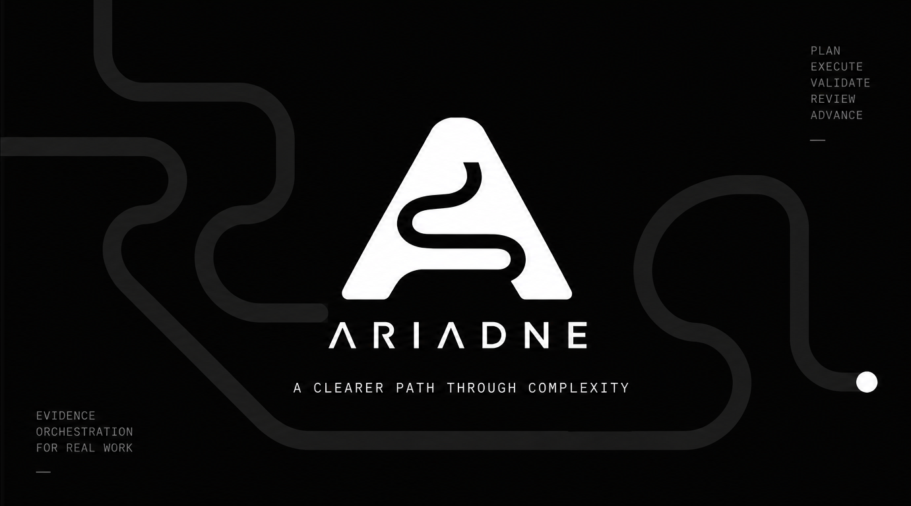

# Ariadne

**An evidence-driven agent runtime for building, reviewing, and verifying software and creative work.**

Ariadne coordinates execution, independent checks, recovery, and human approvals. It does not treat a worker's claim of completion as proof: each important action is bound to a revision, an identity, and the evidence that actually supports it.

[Install](#install) · [skills.sh](https://skills.sh/tanishkfr/ariadne) · [Documentation](#documentation) · [Release v2.4.0](https://github.com/tanishkfr/ariadne/releases/tag/v2.4.0) · [Trust boundaries](docs/guides/TRUST.md)

## What Ariadne does

- **Plans before it spends.** Deterministic code answers what can be known exactly, bounded decision contracts handle closed judgments, and generative workers are used only when creation or open reasoning is genuinely needed.
- **Keeps execution and verification separate.** A worker's summary is an input to verification, not a result. Independent validation and Proof Pass bind the evidence to the revision that produced it.
- **Recovers without guessing.** Interrupted work, failed attempts, and stale evidence stay visible. Recovery stops rather than inventing a successor or silently accepting a partial result.
- **Keeps humans in control.** Direction, dependencies, review, acceptance, shipping, and publishing remain explicit human decisions. Confidence never grants authorization.
- **Works with your agents.** Ariadne is provider-neutral and can use Codex, OpenCode, or a declared CLI harness, while the deterministic core works offline.

## How it works

```text
Task
  |
  +-- Can code decide it? --------- yes -> deterministic execution
  |
  +-- Is it a bounded judgment? ---- yes -> Decision Plane
  |
  +-- Otherwise ------------------------- generative worker
                                                |
                                          verification
                                                |
                                       human authority
```

The engine owns the transitions, not the model. It records what was decided, what was executed, what was verified, and what remains unproven. A later edit can invalidate earlier evidence without deleting it.

## Core capabilities

| Capability | What it gives you |
|---|---|
| **Task planning and bounded execution** | Ordinary-language requests become an explicit task contract with permitted scope, required validation, selected skills, and the gates ahead. |
| **Engineering changes and correction loops** | A worker implements one bounded change; failed validation enters a documented repair budget instead of an open-ended retry loop. |
| **Evidence-based verification** | Proof Pass evaluates the original request against the actual revision and reports proven, partial, unproven, and failed requirements. |
| **Independent review** | Review is bound to a genuinely distinct reviewer execution. An implementer cannot certify their own work. |
| **Design verification** | Declared viewport matrices, real browser captures, interaction assertions, contrast/focus/target checks, and visual regression evidence. |
| **Durable recovery** | Revision fingerprints and durable run state let Ariadne resume, refuse, or escalate honestly after interruption. |
| **Routing and context efficiency** | Deterministic routing, bounded judgments, context reduction, and skill telemetry. Adaptive routing remains shadow-only in 2.4.0. |
| **Human approval gates** | A gate binds a decision, a target, a revision, and an identity. The engine can stop and ask; it cannot manufacture the answer. |
| **Host integration** | `ariadne-host-1` exposes a read-only task, execution, verification, recovery, authority, and resource projection over CLI, API, and MCP, with a durable event cursor. |

The deterministic path is the default. A missing optional provider is recorded as capability state rather than treated as a crash. Design and rendered checks are not a WCAG certification, and the 2.4.0 live qualification used one Windows machine and one Chromium-family browser.

## A practical example

Suppose you ask:

> Fix the failing login validation, add a regression test, and verify the result.

Ariadne interprets the request, discovers the project, and opens a bounded task rather than a full creative project. It records the permitted files and the command that must prove the change, selects the relevant engineering skills, and hands the work to an approved worker with that scope. When the worker returns, Ariadne reruns the validation independently, records the evidence against the exact revision, and only then runs Proof Pass. If the worker changed a file outside the contract or the test still fails, the attempt is rejected or enters a bounded repair; it is not reported as complete.

## Install

Ariadne installs from immutable GitHub release artifacts. It is not published to PyPI: the `ariadne` distribution name already belongs to the unrelated Ariadne GraphQL project, so a plain `pip install ariadne` would fetch the wrong package.

Ariadne needs Python 3.10 or newer. For the `$ariadne` workflow it also uses Codex, OpenCode, or another adapter you configure. The deterministic core needs no paid provider.

### 1. Install the runtime

```bash
python -m pip show ariadne
python -m pip install --user "https://github.com/tanishkfr/ariadne/releases/download/v2.4.0/ariadne-2.4.0-py3-none-any.whl"
python -m ariadne install
python -m ariadne doctor
```

`pip show ariadne` is a safety check. If it describes a GraphQL library, stop and use a separate Python environment; the two distributions cannot coexist in one environment.

`python -m ariadne --version` reports the active runtime version. The launcher keeps an immutable runtime under the platform data directory and registers the managed skill at `~/.agents/skills/ariadne` unless an Ariadne-owned skill is already active there.

| Platform | Ariadne data directory |
|---|---|
| Windows | `%LOCALAPPDATA%\Ariadne` |
| macOS | `~/Library/Application Support/Ariadne` |
| Linux | `$XDG_DATA_HOME/ariadne`, otherwise `~/.local/share/ariadne` |

The first install writes a user-local runtime and a managed Codex skill. No administrator account is required. Full platform, repair, and compatibility detail: [Installation](docs/guides/INSTALL.md).

### 2. Install the agent skill through skills.sh (optional)

The skills CLI installs agent instructions only. It does not install the Python engine. Install and verify the runtime first, then run this inside a project:

```bash
npx skills add tanishkfr/ariadne --skill ariadne
```

Project-local installation writes `.agents/skills/ariadne` in that project and leaves the user-global managed skill alone. The managed skill may already be enough for Codex; install the project-local copy when you want the skills.sh-managed instructions, another compatible agent, or a per-project pin.

Do **not** add `-g` for Codex or OpenCode while a managed Ariadne installation exists. Both global installs target `~/.agents/skills/ariadne`, the same path Ariadne manages, and a global install can replace the managed skill. The tested recovery and the complete supported/unsupported matrix are in [Installation](docs/guides/INSTALL.md#install-the-agent-skill-through-skillssh).

### Which installation do I need?

| Situation | Recommended path |
|---|---|
| Codex, runtime installed | The managed skill from `ariadne install` is sufficient. |
| Codex plus skills.sh management | Install the runtime first, then the skill project-locally. |
| OpenCode | Install the runtime first, then the skill project-locally. |
| Another compatible agent | Install project-locally where the agent supports project skills. |
| No runtime yet | Install the runtime first. The skill alone cannot execute Ariadne. |

## Quick start

1. Run `python -m ariadne doctor` and confirm the runtime, the managed skill, and compatible project state.
2. Open Codex or OpenCode in the project you want to work on and invoke `$ariadne`.
3. Describe the outcome you want in ordinary language.
4. Answer the decisions that genuinely belong to you; Ariadne records them and continues from the durable state.

A fully deterministic, model-free introduction lives in [examples/README.md](examples/README.md). The examples call the same engine the command line uses and need no provider:

```bash
python examples/01_basic_task.py
python examples/04_bounded_decision.py
```

## Supported environments

| Area | Status in 2.4.0 |
|---|---|
| Python | 3.10 or newer; the launcher and runtime are dependency-free. |
| Codex | Default reasoner and `$ariadne` interface; managed skill verified on Windows. |
| OpenCode | Supported project-local skill integration; file layout tested, live execution not claimed here. |
| Other agents | Structurally compatible through project-local skills; not all were executed. |
| Windows | Principal live qualification platform. |
| macOS / Linux | Same Python entry point; not natively executed for 2.4.0. |
| External providers | Optional. A missing provider is reported as capability state; no paid API is required by the deterministic core. |
| Browser checks | Optional. Playwright is not installed by Ariadne; rendered acceptance reports the absence instead of claiming visual success. |

## Security and trust

Ariadne is an execution system, not a sandbox. Read [Trust boundaries](docs/guides/TRUST.md) before relying on it for hostile input or untrusted workers.

- **Approved commands run with your OS privileges.** `--validate` commands are part of the task contract supplied by the operator or orchestrating agent. Ariadne reruns them and records the result; it does not jail them. Do not use an untrusted validation command.
- **Workers cannot grant authority.** A worker return is data. It cannot approve its own work, widen the permitted scope, mint a Proof Pass, or change policy. The engine validates the return and binds evidence to the revision.
- **External content is untrusted evidence.** Fetched pages, provider output, worker returns, and third-party skills cannot grant approvals or become instructions. Prompt injection can still influence a model within its own authority; the engine limits the blast radius but does not eliminate it.
- **External skills require an explicit digest-bound approval.** Discovery is metadata-first, installs are copies, and an unapproved or changed skill is never selected. See [External skill trust](docs/SKILL-TRUST.md).
- **Release artifacts are digest-authenticated, not publisher-signed.** The manifest and SHA-256 checks detect corruption and substitution against the supplied manifest; they do not establish a maintainer signing identity.
- **Audits describe capabilities and exposure, not certification.** As observed on 12 November 2026: [Socket](https://www.skills.sh/tanishkfr/ariadne/ariadne/security/socket) reports **PASS**; [Gen Agent Trust Hub](https://www.skills.sh/tanishkfr/ariadne/ariadne/security/agent-trust-hub) reports **MEDIUM** for command execution, external downloads, external-return ingestion, and external skill loading; [Snyk](https://www.skills.sh/tanishkfr/ariadne/ariadne/security/snyk) reports **MEDIUM W011** (low risk 0.10) for explicitly retrieved third-party content. These are automated findings, not a security certification, and they do not replace the boundaries above.

## Proof Pass

Workers produce. Ariadne determines what is actually proven. Ask Ariadne to verify the work against the original request; it constructs the verification model and returns a receipt that states what was evaluated, against which requirements, using which evidence.

A repair can be verified again and the two receipts compared. Receipts are revision-bound: a later edit can make earlier evidence stale without deleting it. `verify --json` emits a versioned machine-readable receipt for CI, MCP, and conversational integrations. Exit codes are 0 ACCEPTED, 1 NOT_ACCEPTED, 2 VERIFICATION_BLOCKED, and 3 usage or configuration error.

A receipt never claims bug-free, perfect, or guaranteed. It reports requirement-level verdicts and remaining unknowns. The runtime controller and integration surfaces are documented in [Python and CLI API](docs/v2/AR-205/06-RELEASE-API.md) and [Integration protocol](docs/v2/AR-205/04-INTEGRATION-CONTRACT.md).

## A short walkthrough

Suppose you ask Ariadne to fix a failing validation in a source file. In outline, it will:

1. characterise the task and record what kind of work it is;
2. establish the facts code can know, such as which files changed and what the checks currently report;
3. use bounded judgment only where classification is genuinely ambiguous;
4. hand the bounded work to a worker with an explicit scope and acceptance checks;
5. reproduce the result independently instead of trusting the worker's summary;
6. repair once when policy allows, and stop for a human otherwise;
7. append the evidence, so the next step reads a record rather than a recollection.

No step can promote itself, and nothing is accepted on the strength of a claim alone.

## Decision Intelligence

Ariadne does not send every uncertain question to a large generative model. It first asks whether code can answer the question, whether the answer space can be bounded, and whether generation would add real value.

When a question is genuinely bounded, the Decision Plane compiles it into a declared option set, projects only the state that question needs, batches independent questions together, and reuses an answer only when the same state and provider version produced it. If the evidence is insufficient or confidence is unusable, it escalates rather than guessing; a protected action is refused under every confidence value. Every decision records where its confidence came from.

The mechanism is documented in [Decision Intelligence](docs/v2/AR-205D/01-DECISION-COMPILER.md). A Jev-shaped adapter boundary is one example of a possible bounded-decision provider; it is not required, and no live Jev evaluation was executed.

## The Decision Runtime

Ariadne ships a bounded inference engine of its own, so a closed question has somewhere local to be asked. It runs in a separate process, answers one projected state and many independent questions in a single inference, over answer spaces the question already declared, and refuses rather than guesses.

You do not configure it, and there is no provider to choose. Ariadne finds a Decision Runtime or it does not, and the four rules below hold whether it finds one or not.

**It never authorises anything.** Every record it produces carries `authorization_effect: "none"`, and nothing it writes can reach an approval, a verification, or an execution edge.

**It is never verification.** A prediction is not proof. A shadow observation is evidence that the runtime would have answered differently, and nothing more.

**It observes before it influences.** The authoritative answer is decided, judged and recorded first. The runtime's prediction is then stored beside it, in a record that is structurally incapable of carrying an execution effect. This is the default posture, and it is not something you opt into.

**It abstains instead of guessing.** No confidence threshold is applied unless a measured calibration profile justifies one for this exact decision, this question and this exact model revision. With no such profile, no threshold is invented and the answer stands ungated.

`ariadne doctor` reports the runtime alongside the rest of the product, including capability, installation, manifest, concrete model revision, device, protocol, and one bounded smoke question. An absent runtime is optional rather than a fault.

The full documentation is in [docs/v2/2.1/](docs/v2/2.1/README.md).

## Verification and human control

Ariadne keeps five things apart, and none of them substitutes for another:

```text
Decision      !=  Authorization
Execution     !=  Verification
Verification  !=  Acceptance
```

An approval binds a gate, a target, a revision and an identity. A review binds two distinct executions, so an implementer cannot certify their own work. An acceptance spends exactly one human approval. The engine can stop and ask, and it cannot manufacture the answer.

The full statement of what the engine does and does not guarantee is in [Trust boundaries](docs/guides/TRUST.md).

## Design Intelligence

For design work, Ariadne records a provenance chain: requirements, reference findings (found, inspected, analysed or used), component candidates, an approved direction, rendered evidence with its capture parameters, an independent critique, and bounded refinements that stay inside their declared scope.

This is not an automatic taste oracle. Source inspection cannot close a rendered-quality requirement, and a screenshot without capture provenance is not evidence. The chain records what was actually checked.

## Providers

Ariadne is provider-neutral. Four kinds of component are separated by contract:

```text
deterministic providers
decision providers
generative providers
verification adapters
```

No particular paid provider is required by the core engine, and the deterministic path is offline. A missing optional provider is recorded as capability state rather than crashing the run, and the capability registry is the source of truth for what is actually available. A versioned, provider-neutral consumer contract lets another application drive the engine without importing any vendor SDK; see [Integration protocol](docs/v2/AR-205/04-INTEGRATION-CONTRACT.md).

## Benchmarks

The deterministic suite runs offline with no model calls and no network. The 2.4.0 release was evaluated as follows:

```text
Full benchmark: 353 registered cases
Pass: 346   Fail: 0   Error: 0   Observed: 5   Skip: 2

Engine checks: 586/586
AR-230 task execution: 27/29 (2 live opt-in skips)
AR-23C portable intelligence: 22/22
AR-23D revision binding: 25/25
AR-225 universal entry: 51/51
AR-24A execution reliability: 21/21
AR-24A adapter conformance: 2/6 (4 live opt-in skips)
AR-24B intelligence and efficiency: 27/27
AR-24C design, proof and host: 33/33
Rendered critique: 92/92
Release tests: 99/99
Wheel install: 14/14
Distribution lifecycle: 55/55
Release benchmark subset: 97/97
```

The seven documentation/path-drift cases that were red in the 2.4A baseline were closed at their causes in 2.4A-R and remain green; they are not counted as passes. The five observed cases and two declared skips are accounted for in the benchmark results.

`OBSERVED` and `DECLARED_SKIP` are deliberate categories, separate from failure: an observation records a measurement without a judgement, and a skip means a case declared itself not executable in this environment. Neither is counted as a pass. The benchmark proves deterministic mechanics, not model output quality, cost or a success rate. See [benchmarks/README.md](benchmarks/README.md).

## Migration from v1

Existing v1 projects keep working without migration. A run state written before the engine contract is refused until you migrate it, and migration is explicit, dry-runnable, backed up and additive. Ask Ariadne to migrate the project; it shows the dry-run before writing anything. The full command surface and safety rules are in [MIGRATING-v1-to-v2.md](docs/guides/MIGRATING-v1-to-v2.md).

An apply preserves the pre-migration bytes and creates no approval, review or verification record. Rollback restores the preserved bytes while that remains honest, and refuses once v2-only work exists.

## Updates, rollback and removal

Updates download and verify a newer release, and rollback returns to the previous installed version:

```bash
python -m ariadne update
python -m ariadne rollback
```

Removal is two explicit steps:

```bash
python -m ariadne uninstall
python -m pip uninstall ariadne
```

The first command removes the user-local runtime and the managed skill while preserving Projects, project documents, evidence, source files, edited instructions and unrelated user files. The second removes the Python launcher; confirm it is gone with `python -m pip show ariadne`.

## Trust and limitations

Ariadne enforces its own state transitions, approval binding, revision freshness, evidence contracts, review independence and bounded decision contracts. It is honest about what it cannot do:

- it does not sandbox your operating system or jail a validation command;
- it does not cryptographically attest local run-state files;
- it cannot prove an observation a provider never reported;
- it keeps external text as data, but cannot make a model immune to prompt injection inside its own authority;
- its artifacts are authenticated by digest, not signed by a maintainer key;
- one install path was verified on one platform; other platforms use the same Python entry point but were not executed here;
- migration rollback stops being available once v2-only work exists.

These are stated precisely in [TRUST.md](docs/guides/TRUST.md). Platform and host limits are in [HOSTS-AND-LIMITS.md](docs/HOSTS-AND-LIMITS.md).

## Documentation

- [Quick start](docs/guides/QUICKSTART.md) · [Installation](docs/guides/INSTALL.md) · [Getting started](docs/guides/GETTING-STARTED.md)
- [Updates and rollback](docs/guides/UPDATE.md) · [Troubleshooting](docs/guides/TROUBLESHOOTING.md)
- [Python and CLI API](docs/v2/AR-205/06-RELEASE-API.md) · [Integration protocol](docs/v2/AR-205/04-INTEGRATION-CONTRACT.md)
- [Architecture](docs/v2/AR-200/03-ARCHITECTURE.md) · [Workflow](docs/policies/WORKFLOW.md) · [Router](docs/policies/ROUTER.md) · [Task routing](docs/policies/TASK-ROUTING.md)
- [Decision Intelligence](docs/v2/AR-205D/01-DECISION-COMPILER.md) · [Decision Graph](docs/v2/AR-205D/02-DECISION-GRAPH.md)
- [Design Intelligence](docs/v2/AR-202D/02-REFERENCE-INTELLIGENCE.md) · [Design direction](docs/v2/AR-202D/04-DESIGN-DIRECTION.md) · [Design taste](docs/policies/DESIGN-TASTE.md)
- [Trust boundaries](docs/guides/TRUST.md) · [External skill trust](docs/SKILL-TRUST.md) · [Privacy](docs/policies/PRIVACY-POLICY.md) · [Model routing](docs/policies/MODEL-ROUTING.md)
- [Migration guide](docs/guides/MIGRATING-v1-to-v2.md) · [Examples](examples/README.md) · [Benchmarks](benchmarks/README.md)
- [skills.sh listing](https://skills.sh/tanishkfr/ariadne) · [Latest release](https://github.com/tanishkfr/ariadne/releases/tag/v2.4.0)
- [Release notes](RELEASE-NOTES.md) · [Changelog](CHANGELOG.md)

## Licence

Ariadne is available under the [Apache License 2.0](LICENSE).

For security reports, open a private security advisory on the repository rather than a public issue. Include the Ariadne version (`python -m ariadne --version`), the command, and the smallest reproduction you can build.
